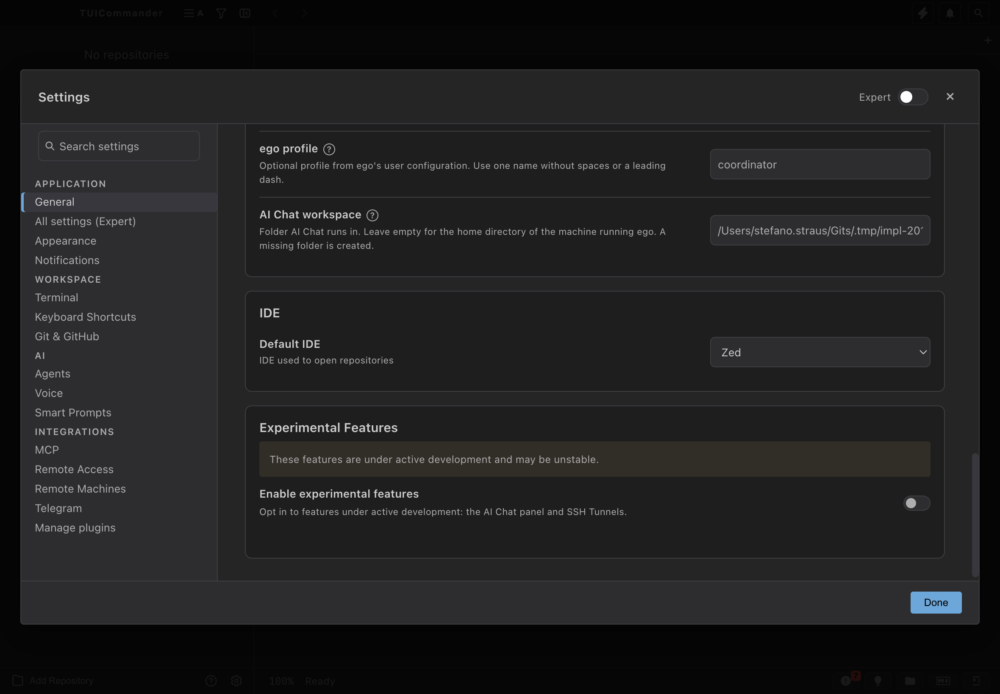

# Headless Settings live refresh — 2014-9d06 / 1788-2163

## Contract

An external Settings write on an isolated `tuic-remote` must update an already open Settings page without a frontend save. The authoritative state is the daemon's Settings owner; the browser receives a value-free `settings-changed` SSE hint and rereads `/config`. Both HTTP and MCP writes were exercised. No production instance, credentials, installed binary or desktop application was used.

## Implementation

- Register `/settings/action` once in `shared_routes()` for desktop and headless HTTP servers.
- Register the existing `/config` GET/PUT owner route there too. Browser hydration and non-saving refresh use its existing secret-redacted snapshot.
- Refuse upstream OAuth before lookup or network access when no desktop host is available. Bridge installation and opening an agent config file remain unsupported Settings workflows on the headless surface.

The headless TCP server still does **not** embed frontend assets or expose `/mcp`. The verification frontend was this worktree's Vite app, with a temporary transparent API proxy to the isolated daemon. Actual MCP requests used the daemon's existing local HTTP-over-Unix-socket listener. Both listeners share the same Settings state and event bus. No HTTP response or frontend state was mocked.

## Isolation and method

- Native binary: this worktree's `src-tauri/target/debug/tuic-remote`, built through mbx and `build-slot.sh` with `--no-default-features`.
- Arguments: `--instance impl-2014-bootstrap --bind 127.0.0.1 --no-agent-configs`.
- `HOME`, `TMPDIR`, `TMP` and `TEMP`: beneath `~/Gits/.tmp/impl-2014-bootstrap-live/`.
- Daemon port: `19889`; worktree Vite port: `19890`; explicit throwaway pairing token.
- Browser: mandated `ab-stealth.sh`, named session `impl-2014-bootstrap`, isolated orphan-reap scope.
- Opened Settings by clicking the real UI. Scrolled the Default IDE control into view. No setting control was edited or saved by the browser.
- Observed browser `fetch` calls during each write/refresh window by wrapping `window.fetch` without changing its arguments or result. Only method and URL were recorded.
- For the MCP demonstration, enabled Settings MCP only on the throwaway daemon through its existing `/config` owner save, initialized a real MCP session, and discovered the Settings schema through `tools/list` before calling `tools/call`.

## Observed effect

### External HTTP write

1. Open Settings showed Default IDE = **VS Code**.
2. Authenticated `POST /settings/action` patched machine store `app`, path `/ide`, to `zed`, using the owner's current revision.
3. Reply: `persisted=true`, `applied=true`, `generation=1`.
4. TCP `/events` emitted exactly `{"section":"app","generation":1,"persisted":true,"applied":true}`.
5. The still-open Settings control became **Zed**.
6. During that window the browser issued exactly one `GET http://127.0.0.1:19890/config`; no PUT/POST/save request was issued.

### Actual MCP write — story 1788 criterion 6

1. Open Settings showed Default IDE = **Zed**.
2. A real MCP `tools/call` invoked `settings` with `action=patch`, machine store `app`, path `/ide`, value `cursor`, and the revision from a preceding MCP `get`.
3. Reply: `persisted=true`, `applied=true`, `generation=3`.
4. MCP readback returned stored/effective value `cursor`; the TCP SSE stream carried the matching value-free change hint.
5. The same open Settings control became **Cursor**, without closing or reopening Settings.
6. Browser observation returned `settingsOpen=true`, `ideValue=cursor`, `selectedLabel=Cursor`, and only one `GET /config`. No save request appeared during this window.

This is MCP-origin state mutation on a throwaway daemon observed by its browser/HTTP consumer. It directly covers the effect, isolated state and refresh-coordinator radius in story **1788-2163 criterion 6**. The HTTP demonstration independently covers story **2014-9d06 REALITY**.

## Screenshots

Before the MCP write:

After the MCP write, without a frontend save:

SHA-256:

- Before: `a6621f4ad79e4a7c860a7f16cfa5f6b9419db480653a9b053de1a8acdb6acea7`
- After: `1aa04c57e4a5ffe41b34873ff3caa0a11033e6c1dc9a69058d2abadc9a1897ad`

Raw evidence under `~/Gits/.tmp/impl-2014-bootstrap-live/`:

- `external-http-write.json`, `ui-before.json`, `ui-after.json`, `before.png`, `after.png`
- `mcp-settings-schema.json`, `mcp-initialize.json`, `mcp-write-proof.json`
- `mcp-ui-before.json`, `mcp-ui-after.json`, `mcp-after-snapshot.txt`
- `health.json`, `config-before.json`, `daemon.log`, `vite.log`

Earlier locked-screen attempts failed and are not used as passing evidence. The final named browser session produced both screenshots without a locked-screen warning.

## Regression evidence and validation

Base for the follow-up: merge `438edfb73535c3ee2eabfecdbf3b6cf53cdcb652`, which includes main `b44551917a`.

- Original route RED at `7747062c295923820f5b240f467c5748c1d82c5b`: both named route/write tests failed on authenticated HTTP 404. This alone did not isolate missing event publication.
- Exact missing-event RED at the merge base: temporarily suppressed only `settings/api.rs::publish_change`'s event publish call while keeping persistence and the route. The unchanged `remote_settings_write_publishes_settings_changed` asserted persistence then failed after 10 seconds with `persisted write never reached SSE: Elapsed(())`. The mutation was fully restored. Exact diff: `~/Gits/.tmp/results/impl-2014-missing-event-mutation.diff`; log: `impl-2014-missing-event-red.log`.
- Bootstrap RED before moving `/config`: `remote_router_serves_settings_bootstrap` failed on authenticated GET 404 vs 200. Log: `impl-2014-bootstrap-red-recovered.log`, receipt `20261018T093728Z-64240`. Earlier fixture compilation and rb disk-space failures are not RED evidence.
- Final rb targeted Nextest: **20/20 passed**, 0.138 seconds execution, 5m24s build. Filter: `test(remote_settings_tests::) | test(settings::api_tests::)`, package `tuicommander`, `--no-default-features`, through `scripts/with-test-tmp.sh` and `build-slot.sh --remote`.
- Final rb `cargo clippy -p tuicommander --all-targets -- -D warnings`: **passed**, 2m59s.
- Final rb `cargo build --bin tuic-remote --no-default-features`: **passed**, 3m57s.
- Authorized native headless build for the live check: **passed**, 2m11s, through mbx/build-slot.
- Combined log: `~/Gits/.tmp/results/impl-2014-bootstrap-green-build.log`; rb receipt `20261018T095126Z-34788`, `RB_BOX_DIRTY=no`.

No full Rust/Vitest suite or second desktop instance was run. The changed behavior is backend routing; no frontend code or styling changed.

## Cleanup

The named browser tab/session was closed. Both owned background execs (Vite and daemon) were cancelled, and HTTP probes confirmed ports `19889` and `19890` were closed. The temporary Vite proxy configuration was removed. Evidence and isolated owner files were retained. The production app was not restarted or modified.
