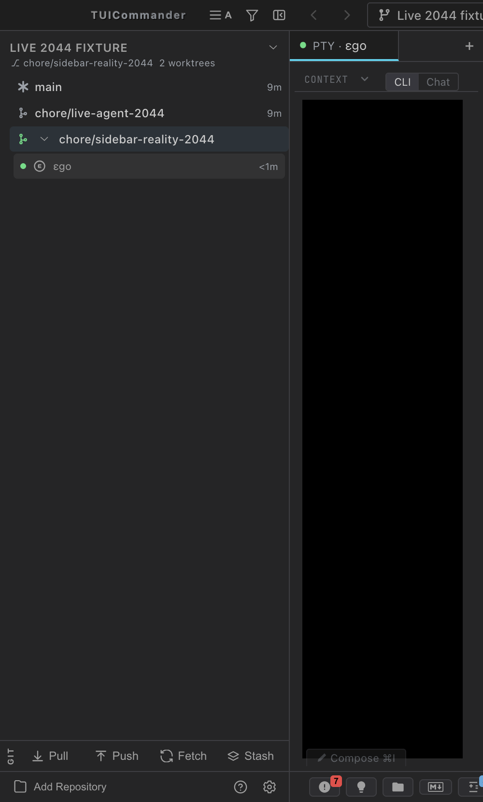

# Story 2044-31f3: isolated live sidebar verification

## Result

PASS: a real ego PTY agent created `chore/sidebar-reality-2044`, declared that worktree, and appeared in the sidebar's **Terminal tabs** group directly below that worktree row. The root workspace and the caller's previous workspace both had zero terminals. The caller's actual working directory stayed in the repository root.

This verifies acceptance criterion 4 in browser mode. No production code changed.

## Isolation and runtime

- Source checkout: `chore/live-2044-sidebar`, source commit `044ba1bfa6`, with the landed 2044 fixes inherited from main.
- Native executable: this checkout's `src-tauri/target/debug/tuic-remote`, built with `PATH="$HOME/Library/Application Support/mbx/bin:/opt/homebrew/bin:$PATH"` and `tools/build/build-slot.sh cargo build --manifest-path src-tauri/Cargo.toml --bin tuic-remote --no-default-features` from the orchestrator checkout's tools. `mbx doctor` reported zero failures.
- Native build passed in 2m 03s after a 100-second admission wait. This was an explicitly authorized Mac runtime build, not an rb test run.
- Backend: `--instance live-2044 --bind 127.0.0.1 --no-agent-configs`, private TCP port **19444**. Its `HOME`, temporary socket directory and debug file vault were isolated under `~/Gits/.tmp/results/live-2044-isolated/`.
- UI: the same checkout's Vite on **19445**, launched through the local build slot. A temporary Vite config proxied HTTP, SSE and WebSocket API paths to the isolated backend's Unix socket. The TCP daemon router intentionally omits `/config/repositories`; the Unix listener exposes the full application router needed by the desktop frontend. No API response was mocked.
- Browser: the mandatory `ab-stealth.sh` wrapper, unique session `live-2044-isolated`, after a successful wrapper smoke check. Only the worktree Vite page was captured.
- Fixture: a newly initialized disposable Git repository under the evidence directory. No registered production repository, installed executable, production config or running desktop instance was changed. No request went to port 9876.

The browser exposes `window.__TUIC__.store(...)`. The state evidence uses `agent-browser eval` against that browser page, **not** the installed desktop app's MCP `invoke_js` endpoint. DOM and screenshot evidence independently show the rendered sidebar.

## Live sequence and assertions

1. The isolated backend spawned ego in a real PTY, session `6f1c5b1a-cc27-4877-b019-b8f037631bd5`.
2. The real agent used its exec tool to run the local CLI operations. The CLI inherited the backend-issued `TUIC_SESSION` and the isolated `TUIC_SOCKET`.
3. The agent called `repo action=worktree_create`, then `session action=declare_worktree` with the returned path. Both responses were recorded, not synthesized.
4. An independent SSE observer and the browser were connected before this final create/declare sequence. The observer recorded `worktree-created`, then `session-worktree-declared`, both naming the live caller and `chore/sidebar-reality-2044`.
5. Without a browser reload, the frontend snapshot reported one terminal in `chore/sidebar-reality-2044`, zero in `main`, and zero in `chore/live-agent-2044`.
6. The DOM contained the `chore/sidebar-reality-2044` row, an expanded **Show or hide agents (1)** control, then a **Terminal tabs** group with the ego button. A separate DOM capture checked that this group followed the correct worktree row and that the agent button's top coordinate was below the row's bottom coordinate.
7. `/sessions` identified that same caller, its declared worktree path and branch, while `cwd` still identified the root fixture repository. The durable repository response retained the matching declaration and restore record.

The nested-tab preference defaults to off. This isolated instance enabled the existing `tab_tree_enabled` setting through the normal config save API before the final run. No sidebar click handler or layout code changed.

## Evidence

Machine-readable files are in [2026-10-19-2044-sidebar-reality](2026-10-19-2044-sidebar-reality/):

- `health.json`: native backend identity, build digest and private socket.
- `reality-create.json`, `reality-declare.json`, `reality-cwd.json`: real agent operation results and unchanged cwd.
- `reality-submit.json`: delivery acknowledgement for the real PTY instruction.
- `reality-events.txt`: independently observed create/declaration SSE events.
- `reality-sidebar-dom.txt`: browser accessibility DOM.
- `reality-placement-dom.json`: rendered row/group relationship and bounding rectangles.
- `reality-debug.json`: browser `__TUIC__` snapshots, sidebar HTML and frontend logs.
- `reality-repositories.json`, `reality-sessions.json`: backend API state after the live declaration.
- `cleanup.json`: fixture, browser and process cleanup evidence.

The complete local run evidence, build logs, agent transcript and harness inputs remain at `~/Gits/.tmp/results/live-2044-isolated/`. The wrapper prerequisite evidence is at `~/Gits/.tmp/ego-browser-live-2044-smoke/`.

## Harness corrections and limits

Earlier attempts were not counted as a pass: the first launcher let ego-only launch flags reach Python; the first model turn omitted the CLI's positional JSON argument; and the initial Vite proxy did not match top-level API URLs with query strings. The final run used a real executable launcher, the exact CLI JSON contract, and a query-aware proxy. Its recorded SSE events distinguish the verified run from those setup attempts. A write outside the child agent's workspace was refused; subsequent output stayed inside its fixture workspace and was copied into the evidence directory by the verification owner.

This is native macOS headless-backend plus browser-mode evidence. It does not claim that Boss restarted the installed desktop backend or that native Tauri event delivery was exercised. Existing RED and GREEN evidence in the story covers the landed code; no new regression test or production fix was needed for this verification task.

## Cleanup

The agent PTY was deleted through the isolated API. All three disposable linked worktrees were removed through the isolated TUIC repo service. The named browser session was closed; a CDP inventory check confirmed that its recorded target was absent. The verification Vite process group and native backend process group were stopped by their recorded PIDs. The temporary Vite configuration was removed. The disposable root repository and isolated instance files are retained only as local evidence.
